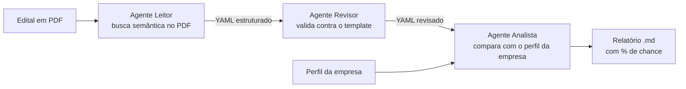

# LicitSmart — Análise de editais com agentes de IA

[](https://www.python.org/)
[](https://www.crewai.com/)
[](https://www.langchain.com/)
[](https://platform.openai.com/)

Projeto desenvolvido em um **hackathon** para resolver um problema real de empresas que participam de licitações públicas: editais são PDFs longos e heterogêneos, e decidir se vale a pena concorrer exige horas de leitura técnica.

O LicitSmart lê os editais automaticamente, extrai as informações que importam e compara as exigências com o perfil da empresa, gerando um **relatório de compatibilidade com a estimativa de chance de vitória**.

## Como funciona

Um pipeline sequencial de agentes com CrewAI processa cada PDF:



1. **Leitor de Editais**: usa o `PDFSearchTool` (RAG sobre o PDF) para extrair objetivos, exigências técnicas e documentais, oportunidades, prazos, limitações, recomendações e inconsistências do edital, em um YAML padronizado.
2. **Revisor**: confere se o YAML segue o template e se todos os pontos solicitados foram atendidos.
3. **Analista de Compatibilidade**: cruza o edital com o perfil da empresa (certificações, experiência, porte, capacidade financeira) e gera o relatório final, com pontos fortes, pontos fracos, recomendações e percentual de chance.

O prompt usa blocos delimitados (`<solicitacoes>`, `<template>`, `<controle>`, `<restricoes>`) para controlar o formato, o tom e o escopo da saída.

Um exemplo de relatório gerado está em [`relatorio.md`](./relatorio.md), a partir do edital de exemplo em [`PDFs/`](./PDFs).

## Arquivos

| Arquivo | O que faz |
|---|---|
| `script.py` | Pipeline completo: leitura, revisão e análise de compatibilidade com o perfil da empresa |
| `script_v2.py` | Versão só de extração: leitura e revisão do edital, sem a análise de compatibilidade |
| `PDFs/` | Editais a analisar |
| `relatorio.md` | Exemplo de saída |

## Como rodar

Pré-requisitos: Python 3.10+ e uma chave da OpenAI com acesso ao GPT-4.

```bash
git clone https://github.com/johnpaulo0602/licitsmart.git
cd licitsmart
python -m venv venv && source venv/bin/activate   # Windows: venv\Scripts\activate
pip install -r requirements.txt
echo "OPENAI_API_KEY=sua-chave" > .env
```

Coloque os editais em `PDFs/`, ajuste o perfil da empresa no início do `script.py` e execute:

```bash
python script.py
```

Cada edital gera um arquivo `<nome-do-edital>_relatorio.md`.

## Limitações conhecidas

- Protótipo de hackathon: o perfil da empresa fica fixo no código, e não há interface nem testes.
- A porcentagem de chance é uma estimativa do modelo, não um cálculo determinístico.
- O custo e o tempo crescem com o tamanho do edital, porque cada PDF passa por três agentes.
